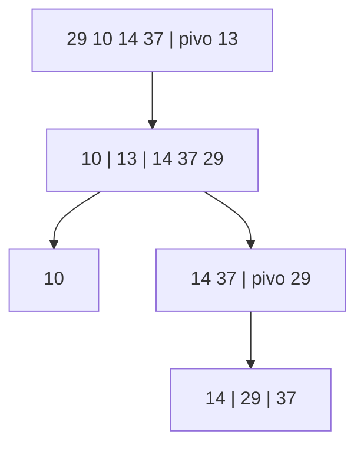

# Busca e Ordenação - Respostas

Padrões seguidos (`cesar/refs`): C++ com `<iostream>` e `using namespace std;`, `cout`/`cin`, comentário `//` acima de cada função, `if`/`while` de uma linha sem chaves. Apenas `<iostream>` e `<stdlib.h>`.

---

## Q1 - Busca sequencial: todas as posições

> Modifique a busca sequencial para retornar todas as posições em que o valor procurado aparece.
> Exemplo: Vetor `[4,8,2,8,5,8,1]`, valor `8`.

```cpp
#include <iostream>
#include <stdlib.h>

using namespace std;

// Busca sequencial: exibe todas as posições do valor
void buscaSequencial(int vetor[], int tamanho, int valor) {
    int encontrou = 0;

    for (int i = 0; i < tamanho; i++) {
        if (vetor[i] == valor) {
            cout << "Encontrado na posicao: " << i << "\n";
            encontrou = 1;
        }
    }

    if (!encontrou)
        cout << "Valor nao encontrado.\n";
}

int main() {
    int vetor[] = {4, 8, 2, 8, 5, 8, 1};
    int tamanho = 7;
    int valor = 8;

    buscaSequencial(vetor, tamanho, valor);

    return 0;
}
```

```
Encontrado na posicao: 1
Encontrado na posicao: 3
Encontrado na posicao: 5
```

---

## Q2 - Busca binária: primeira ocorrência

> Modifique a busca binária para retornar a primeira posição em que determinado elemento aparece.
> Exemplo: `[2, 4, 4, 4, 7, 9, 11]`, procurando `4`.

Ao encontrar o valor, guarda a posição e continua procurando à esquerda (`fim = meio - 1`).

```cpp
#include <iostream>
#include <stdlib.h>

using namespace std;

// Busca binária: retorna a primeira ocorrência do valor
int buscaBinaria(int vetor[], int tamanho, int valor) {
    int inicio = 0;
    int fim = tamanho - 1;
    int posicao = -1;

    while (inicio <= fim) {
        int meio = (inicio + fim) / 2;

        if (vetor[meio] == valor) {
            posicao = meio;
            fim = meio - 1;
        } else if (vetor[meio] < valor)
            inicio = meio + 1;
        else
            fim = meio - 1;
    }

    return posicao;
}

int main() {
    int vetor[] = {2, 4, 4, 4, 7, 9, 11};
    int tamanho = 7;
    int valor = 4;

    int resultado = buscaBinaria(vetor, tamanho, valor);

    cout << "Primeira ocorrencia: " << resultado << "\n";

    return 0;
}
```

```
Primeira ocorrencia: 1
```

---

## Q3 - Busca binária: posição de inserção

> Modifique a busca binária para retornar a posição onde o elemento deveria ser inserido caso não exista.

Quando o laço termina sem encontrar, `inicio` aponta para o primeiro elemento maior que o valor.

```cpp
#include <iostream>
#include <stdlib.h>

using namespace std;

// Busca binária: retorna a posição do valor ou onde ele deveria ser inserido
int buscaBinaria(int vetor[], int tamanho, int valor) {
    int inicio = 0;
    int fim = tamanho - 1;

    while (inicio <= fim) {
        int meio = (inicio + fim) / 2;

        if (vetor[meio] == valor)
            return meio;
        else if (vetor[meio] < valor)
            inicio = meio + 1;
        else
            fim = meio - 1;
    }

    return inicio;
}

int main() {
    int vetor[] = {2, 5, 8, 12, 16, 20};
    int tamanho = 6;
    int valor = 10;

    int posicao = buscaBinaria(vetor, tamanho, valor);

    cout << "Posicao: " << posicao << "\n";

    return 0;
}
```

```
Posicao: 3
```

---

## Q4 - Lista de Atendimento (Insertion Sort + busca sequencial modificada)

> Uma clínica registrou os tempos de espera dos pacientes. O sistema precisa ordenar os tempos e contar quantos pacientes esperaram mais do que um tempo informado.
> Requisitos: ordenar os tempos com Insertion Sort. Depois, contar quantos valores são maiores que o limite informado.

```cpp
#include <iostream>
#include <stdlib.h>

using namespace std;

// Insertion Sort
void insertionSort(int vetor[], int tamanho) {
    for (int i = 1; i < tamanho; i++) {
        int chave = vetor[i];
        int j = i - 1;

        while (j >= 0 && vetor[j] > chave) {
            vetor[j + 1] = vetor[j];
            j--;
        }

        vetor[j + 1] = chave;
    }
}

// Busca sequencial modificada: conta os valores acima do limite
int contarAcimaLimite(int vetor[], int tamanho, int limite) {
    int contador = 0;

    for (int i = 0; i < tamanho; i++)
        if (vetor[i] > limite)
            contador++;

    return contador;
}

void imprimirVetor(int vetor[], int tamanho) {
    for (int i = 0; i < tamanho; i++)
        cout << vetor[i] << " ";
    cout << "\n";
}

int main() {
    int tempos[] = {35, 10, 50, 20, 45, 15, 60};
    int tamanho = 7;
    int limite;

    insertionSort(tempos, tamanho);

    cout << "Tempos ordenados: ";
    imprimirVetor(tempos, tamanho);

    cout << "Informe o limite de espera: ";
    cin >> limite;

    int quantidade = contarAcimaLimite(tempos, tamanho, limite);

    cout << "Pacientes que esperaram mais de " << limite << " minutos: " << quantidade << "\n";

    return 0;
}
```

```
Tempos ordenados: 10 15 20 35 45 50 60
Informe o limite de espera: 30
Pacientes que esperaram mais de 30 minutos: 4
```

---

## Q5 - Menor valor acima do limite (Insertion Sort + busca sequencial)

> Uma transportadora registra pesos. Ordene com Insertion Sort e busque sequencialmente.
> Implemente uma função que encontre o menor peso acima de um valor informado.
> Exemplo: `[15,22,8,31,18]`, limite `20` → resultado `22`.

Com o vetor ordenado, o primeiro elemento maior que o limite já é o menor acima dele.

```cpp
#include <iostream>
#include <stdlib.h>

using namespace std;

// Insertion Sort
void insertionSort(int vetor[], int tamanho) {
    for (int i = 1; i < tamanho; i++) {
        int chave = vetor[i];
        int j = i - 1;

        while (j >= 0 && vetor[j] > chave) {
            vetor[j + 1] = vetor[j];
            j--;
        }

        vetor[j + 1] = chave;
    }
}

// Busca sequencial modificada: menor valor acima do limite
int buscarMenorAcima(int vetor[], int tamanho, int limite) {
    for (int i = 0; i < tamanho; i++)
        if (vetor[i] > limite)
            return vetor[i];

    return -1;
}

int main() {
    int pesos[] = {15, 22, 8, 31, 18};
    int tamanho = 5;
    int limite = 20;

    insertionSort(pesos, tamanho);

    int resultado = buscarMenorAcima(pesos, tamanho, limite);

    if (resultado != -1)
        cout << "Menor peso acima do limite: " << resultado << "\n";
    else
        cout << "Nenhum peso acima do limite.\n";

    return 0;
}
```

```
Menor peso acima do limite: 22
```

---

## Q6 - Busca do Valor Mais Próximo (Selection Sort + busca binária modificada)

> Uma loja deseja encontrar o produto com preço mais próximo de um valor informado pelo cliente.
> Requisitos: ordenar os preços. Usar lógica de busca binária para retornar o preço mais próximo do valor informado.

A cada `meio` visitado, compara a distância `abs(vetor[meio] - valor)` com a do melhor candidato até agora.

```cpp
#include <iostream>
#include <stdlib.h>

using namespace std;

// Selection Sort
void selectionSort(int vetor[], int tamanho) {
    for (int i = 0; i < tamanho - 1; i++) {
        int menor = i;

        for (int j = i + 1; j < tamanho; j++)
            if (vetor[j] < vetor[menor])
                menor = j;

        int aux = vetor[i];
        vetor[i] = vetor[menor];
        vetor[menor] = aux;
    }
}

// Busca binária modificada: valor mais próximo
int buscaMaisProximo(int vetor[], int tamanho, int valor) {
    int inicio = 0;
    int fim = tamanho - 1;
    int proximo = vetor[0];

    while (inicio <= fim) {
        int meio = (inicio + fim) / 2;

        if (abs(vetor[meio] - valor) < abs(proximo - valor))
            proximo = vetor[meio];

        if (vetor[meio] == valor)
            return vetor[meio];
        else if (vetor[meio] < valor)
            inicio = meio + 1;
        else
            fim = meio - 1;
    }

    return proximo;
}

int main() {
    int precos[] = {50, 20, 80, 35, 100};
    int tamanho = 5;
    int valor = 40;

    selectionSort(precos, tamanho);

    int resultado = buscaMaisProximo(precos, tamanho, valor);

    cout << "Preco mais proximo: " << resultado << "\n";

    return 0;
}
```

```
Preco mais proximo: 35
```

---

## Q7 - Quick Sort básico

> Implemente o Quick Sort para ordenar um vetor de inteiros em ordem crescente.
> Exemplo: `[29, 10, 14, 37, 13]`.

Escolhe o último elemento como **pivô**, coloca os menores à esquerda e os maiores à direita (`particionar`), e repete para cada lado.



```cpp
#include <iostream>
#include <stdlib.h>

using namespace std;

// Particionar: pivô é o último elemento
int particionar(int vetor[], int inicio, int fim) {
    int pivo = vetor[fim];
    int i = inicio - 1;

    for (int j = inicio; j < fim; j++) {
        if (vetor[j] < pivo) {
            i++;
            int aux = vetor[i];
            vetor[i] = vetor[j];
            vetor[j] = aux;
        }
    }

    int aux = vetor[i + 1];
    vetor[i + 1] = vetor[fim];
    vetor[fim] = aux;

    return i + 1;
}

// Quick Sort
void quickSort(int vetor[], int inicio, int fim) {
    if (inicio < fim) {
        int p = particionar(vetor, inicio, fim);
        quickSort(vetor, inicio, p - 1);
        quickSort(vetor, p + 1, fim);
    }
}

void imprimirVetor(int vetor[], int tamanho) {
    for (int i = 0; i < tamanho; i++)
        cout << vetor[i] << " ";
    cout << "\n";
}

int main() {
    int vetor[] = {29, 10, 14, 37, 13};
    int tamanho = 5;

    cout << "Original: ";
    imprimirVetor(vetor, tamanho);

    quickSort(vetor, 0, tamanho - 1);

    cout << "Ordenado: ";
    imprimirVetor(vetor, tamanho);

    return 0;
}
```

```
Original: 29 10 14 37 13
Ordenado: 10 13 14 29 37
```

---

## Q8 - Ranking de Notas (Quick Sort decrescente)

> Uma escola deseja exibir o ranking dos alunos da maior para a menor nota.
> Requisitos: ordenar as notas com Quick Sort em ordem **decrescente** e exibir as 3 maiores.
> Exemplo: `[7, 9, 4, 10, 6, 8]`.

Basta inverter a comparação no `particionar` (`>` em vez de `<`).

```cpp
#include <iostream>
#include <stdlib.h>

using namespace std;

// Particionar decrescente: maiores que o pivô vão para a esquerda
int particionar(int vetor[], int inicio, int fim) {
    int pivo = vetor[fim];
    int i = inicio - 1;

    for (int j = inicio; j < fim; j++) {
        if (vetor[j] > pivo) {
            i++;
            int aux = vetor[i];
            vetor[i] = vetor[j];
            vetor[j] = aux;
        }
    }

    int aux = vetor[i + 1];
    vetor[i + 1] = vetor[fim];
    vetor[fim] = aux;

    return i + 1;
}

// Quick Sort
void quickSort(int vetor[], int inicio, int fim) {
    if (inicio < fim) {
        int p = particionar(vetor, inicio, fim);
        quickSort(vetor, inicio, p - 1);
        quickSort(vetor, p + 1, fim);
    }
}

int main() {
    int notas[] = {7, 9, 4, 10, 6, 8};
    int tamanho = 6;

    quickSort(notas, 0, tamanho - 1);

    cout << "Ranking: ";
    for (int i = 0; i < tamanho; i++)
        cout << notas[i] << " ";
    cout << "\n";

    cout << "Top 3: ";
    for (int i = 0; i < 3 && i < tamanho; i++)
        cout << notas[i] << " ";
    cout << "\n";

    return 0;
}
```

```
Ranking: 10 9 8 7 6 4
Top 3: 10 9 8
```

---

## Q9 - Consulta de Estoque (Quick Sort + busca binária)

> Um mercado guarda os códigos dos produtos em estoque fora de ordem. O sistema precisa ordenar os códigos e verificar se um código informado pelo usuário existe.
> Requisitos: ordenar com Quick Sort. Depois, usar busca binária para informar a posição do código ou que ele não está em estoque.
> Exemplo: `[305, 120, 478, 210, 99, 360]`, procurando `210`.

A busca binária só funciona com o vetor **ordenado** — por isso o Quick Sort vem antes.

```cpp
#include <iostream>
#include <stdlib.h>

using namespace std;

// Particionar: pivô é o último elemento
int particionar(int vetor[], int inicio, int fim) {
    int pivo = vetor[fim];
    int i = inicio - 1;

    for (int j = inicio; j < fim; j++) {
        if (vetor[j] < pivo) {
            i++;
            int aux = vetor[i];
            vetor[i] = vetor[j];
            vetor[j] = aux;
        }
    }

    int aux = vetor[i + 1];
    vetor[i + 1] = vetor[fim];
    vetor[fim] = aux;

    return i + 1;
}

// Quick Sort
void quickSort(int vetor[], int inicio, int fim) {
    if (inicio < fim) {
        int p = particionar(vetor, inicio, fim);
        quickSort(vetor, inicio, p - 1);
        quickSort(vetor, p + 1, fim);
    }
}

// Busca binária
int buscaBinaria(int vetor[], int tamanho, int valor) {
    int inicio = 0;
    int fim = tamanho - 1;

    while (inicio <= fim) {
        int meio = (inicio + fim) / 2;

        if (vetor[meio] == valor)
            return meio;
        else if (vetor[meio] < valor)
            inicio = meio + 1;
        else
            fim = meio - 1;
    }

    return -1;
}

int main() {
    int codigos[] = {305, 120, 478, 210, 99, 360};
    int tamanho = 6;
    int codigo;

    quickSort(codigos, 0, tamanho - 1);

    cout << "Codigos ordenados: ";
    for (int i = 0; i < tamanho; i++)
        cout << codigos[i] << " ";
    cout << "\n";

    cout << "Informe o codigo: ";
    cin >> codigo;

    int posicao = buscaBinaria(codigos, tamanho, codigo);

    if (posicao != -1)
        cout << "Codigo " << codigo << " encontrado na posicao " << posicao << "\n";
    else
        cout << "Codigo " << codigo << " nao esta em estoque.\n";

    return 0;
}
```

```
Codigos ordenados: 99 120 210 305 360 478
Informe o codigo: 210
Codigo 210 encontrado na posicao 2
```

---

## Q10 - Mediana dos Salários (Quick Sort + acesso por posição)

> Uma empresa quer saber a mediana dos salários dos funcionários.
> Requisitos: ordenar com Quick Sort. Se a quantidade for ímpar, a mediana é o elemento do meio; se for par, é a média dos dois do meio.
> Exemplo: `[3200, 1800, 5000, 2500, 4100, 2900]`.

```cpp
#include <iostream>
#include <stdlib.h>

using namespace std;

// Particionar: pivô é o último elemento
int particionar(int vetor[], int inicio, int fim) {
    int pivo = vetor[fim];
    int i = inicio - 1;

    for (int j = inicio; j < fim; j++) {
        if (vetor[j] < pivo) {
            i++;
            int aux = vetor[i];
            vetor[i] = vetor[j];
            vetor[j] = aux;
        }
    }

    int aux = vetor[i + 1];
    vetor[i + 1] = vetor[fim];
    vetor[fim] = aux;

    return i + 1;
}

// Quick Sort
void quickSort(int vetor[], int inicio, int fim) {
    if (inicio < fim) {
        int p = particionar(vetor, inicio, fim);
        quickSort(vetor, inicio, p - 1);
        quickSort(vetor, p + 1, fim);
    }
}

// Mediana: vetor precisa estar ordenado
float mediana(int vetor[], int tamanho) {
    if (tamanho % 2 == 1)
        return vetor[tamanho / 2];
    return (vetor[tamanho / 2 - 1] + vetor[tamanho / 2]) / 2.0;
}

int main() {
    int salarios[] = {3200, 1800, 5000, 2500, 4100, 2900};
    int tamanho = 6;

    quickSort(salarios, 0, tamanho - 1);

    cout << "Salarios ordenados: ";
    for (int i = 0; i < tamanho; i++)
        cout << salarios[i] << " ";
    cout << "\n";

    cout << "Mediana: " << mediana(salarios, tamanho) << "\n";

    return 0;
}
```

```
Salarios ordenados: 1800 2500 2900 3200 4100 5000
Mediana: 3050
```

---

## Q11 - Insertion Sort passo a passo

> Implemente o Insertion Sort e exiba o vetor ao final de cada passada.
> Exemplo: `[5, 2, 4, 6, 1, 3]`.

A cada passada, a `chave` é inserida na posição correta da parte já ordenada (à esquerda), deslocando os maiores uma casa para a direita.

```cpp
#include <iostream>
#include <stdlib.h>

using namespace std;

void imprimirVetor(int vetor[], int tamanho) {
    for (int i = 0; i < tamanho; i++)
        cout << vetor[i] << " ";
    cout << "\n";
}

// Insertion Sort: exibe o vetor após cada passada
void insertionSort(int vetor[], int tamanho) {
    for (int i = 1; i < tamanho; i++) {
        int chave = vetor[i];
        int j = i - 1;

        while (j >= 0 && vetor[j] > chave) {
            vetor[j + 1] = vetor[j];
            j--;
        }

        vetor[j + 1] = chave;

        cout << "Passada " << i << ": ";
        imprimirVetor(vetor, tamanho);
    }
}

int main() {
    int vetor[] = {5, 2, 4, 6, 1, 3};
    int tamanho = 6;

    insertionSort(vetor, tamanho);

    return 0;
}
```

```
Passada 1: 2 5 4 6 1 3
Passada 2: 2 4 5 6 1 3
Passada 3: 2 4 5 6 1 3
Passada 4: 1 2 4 5 6 3
Passada 5: 1 2 3 4 5 6
```

---

## Q12 - Inserir em vetor ordenado (lógica do Insertion Sort)

> Um professor mantém as notas da turma em ordem crescente. Quando chega uma nova nota, ela deve ser inserida sem precisar reordenar o vetor inteiro.
> Requisitos: usar a lógica de uma passada do Insertion Sort para inserir o novo valor na posição correta.
> Exemplo: `[3, 5, 7, 8, 10]`, inserir `6`.

```cpp
#include <iostream>
#include <stdlib.h>

using namespace std;

// Insere o valor mantendo o vetor ordenado; retorna o novo tamanho
int inserirOrdenado(int vetor[], int tamanho, int valor) {
    int j = tamanho - 1;

    while (j >= 0 && vetor[j] > valor) {
        vetor[j + 1] = vetor[j];
        j--;
    }

    vetor[j + 1] = valor;
    return tamanho + 1;
}

void imprimirVetor(int vetor[], int tamanho) {
    for (int i = 0; i < tamanho; i++)
        cout << vetor[i] << " ";
    cout << "\n";
}

int main() {
    int notas[10] = {3, 5, 7, 8, 10}; // capacidade 10
    int tamanho = 5;

    cout << "Antes: ";
    imprimirVetor(notas, tamanho);

    tamanho = inserirOrdenado(notas, tamanho, 6);

    cout << "Depois: ";
    imprimirVetor(notas, tamanho);

    return 0;
}
```

```
Antes: 3 5 7 8 10
Depois: 3 5 6 7 8 10
```

---

## Q13 - Ranking de Alunos (Insertion Sort + struct)

> Uma turma registrou nome e nota dos alunos. O sistema deve exibir os alunos da maior para a menor nota.
> Requisitos: criar a struct `Aluno` (nome e nota) e ordenar o vetor de structs com Insertion Sort em ordem **decrescente** de nota.

A `chave` passa a ser uma struct inteira; a comparação usa o campo `nota`.

```cpp
#include <iostream>
#include <stdlib.h>

using namespace std;

typedef struct {
    char nome[50];
    float nota;
} Aluno;

// Insertion Sort decrescente pelo campo nota
void insertionSort(Aluno vetor[], int tamanho) {
    for (int i = 1; i < tamanho; i++) {
        Aluno chave = vetor[i];
        int j = i - 1;

        while (j >= 0 && vetor[j].nota < chave.nota) {
            vetor[j + 1] = vetor[j];
            j--;
        }

        vetor[j + 1] = chave;
    }
}

int main() {
    Aluno turma[] = {
        {"Ana", 7.5},
        {"Bruno", 9.0},
        {"Carla", 6.0},
        {"Diego", 8.5}
    };
    int tamanho = 4;

    insertionSort(turma, tamanho);

    for (int i = 0; i < tamanho; i++)
        cout << (i + 1) << "o " << turma[i].nome << " - " << turma[i].nota << "\n";

    return 0;
}
```

```
1o Bruno - 9
2o Diego - 8.5
3o Ana - 7.5
4o Carla - 6
```

---

## Q14 - Selection Sort passo a passo (contando trocas)

> Implemente o Selection Sort, exiba o vetor ao final de cada passada e conte quantas trocas foram feitas.
> Exemplo: `[64, 25, 12, 22, 11]`.

A cada passada, procura o **menor** elemento da parte não ordenada e troca com a posição `i`. Só conta a troca quando `menor != i`.

```cpp
#include <iostream>
#include <stdlib.h>

using namespace std;

void imprimirVetor(int vetor[], int tamanho) {
    for (int i = 0; i < tamanho; i++)
        cout << vetor[i] << " ";
    cout << "\n";
}

// Selection Sort: exibe cada passada e retorna o número de trocas
int selectionSort(int vetor[], int tamanho) {
    int trocas = 0;

    for (int i = 0; i < tamanho - 1; i++) {
        int menor = i;

        for (int j = i + 1; j < tamanho; j++)
            if (vetor[j] < vetor[menor])
                menor = j;

        if (menor != i) {
            int aux = vetor[i];
            vetor[i] = vetor[menor];
            vetor[menor] = aux;
            trocas++;
        }

        cout << "Passada " << (i + 1) << ": ";
        imprimirVetor(vetor, tamanho);
    }

    return trocas;
}

int main() {
    int vetor[] = {64, 25, 12, 22, 11};
    int tamanho = 5;

    int trocas = selectionSort(vetor, tamanho);

    cout << "Trocas: " << trocas << "\n";

    return 0;
}
```

```
Passada 1: 11 25 12 22 64
Passada 2: 11 12 25 22 64
Passada 3: 11 12 22 25 64
Passada 4: 11 12 22 25 64
Trocas: 3
```

---

## Q15 - Pódio da Corrida (Selection Sort parcial)

> Uma corrida registrou os tempos (em segundos) dos atletas. O sistema deve exibir apenas os 3 melhores tempos.
> Requisitos: usar a lógica do Selection Sort, mas executar **apenas k passadas** (k = 3), já que cada passada coloca o próximo menor na posição certa.
> Exemplo: `[58, 42, 61, 39, 50, 45]`.

```cpp
#include <iostream>
#include <stdlib.h>

using namespace std;

// Selection Sort parcial: só as k primeiras posições ficam ordenadas
void selectionSortParcial(int vetor[], int tamanho, int k) {
    for (int i = 0; i < k && i < tamanho - 1; i++) {
        int menor = i;

        for (int j = i + 1; j < tamanho; j++)
            if (vetor[j] < vetor[menor])
                menor = j;

        int aux = vetor[i];
        vetor[i] = vetor[menor];
        vetor[menor] = aux;
    }
}

int main() {
    int tempos[] = {58, 42, 61, 39, 50, 45};
    int tamanho = 6;
    int k = 3;

    selectionSortParcial(tempos, tamanho, k);

    cout << "Podio: ";
    for (int i = 0; i < k; i++)
        cout << tempos[i] << "s ";
    cout << "\n";

    return 0;
}
```

```
Podio: 39s 42s 45s
```

---

## Q16 - Catálogo de Produtos (Selection Sort + struct)

> Uma loja cadastrou produtos com nome e preço. O sistema deve listar os produtos do mais barato para o mais caro e informar o mais barato e o mais caro.
> Requisitos: criar a struct `Produto` (nome e preço) e ordenar com Selection Sort pelo campo `preco`.

```cpp
#include <iostream>
#include <stdlib.h>

using namespace std;

typedef struct {
    char nome[30];
    float preco;
} Produto;

// Selection Sort crescente pelo campo preco
void selectionSort(Produto vetor[], int tamanho) {
    for (int i = 0; i < tamanho - 1; i++) {
        int menor = i;

        for (int j = i + 1; j < tamanho; j++)
            if (vetor[j].preco < vetor[menor].preco)
                menor = j;

        Produto aux = vetor[i];
        vetor[i] = vetor[menor];
        vetor[menor] = aux;
    }
}

int main() {
    Produto produtos[] = {
        {"Arroz", 25.90},
        {"Feijao", 8.50},
        {"Cafe", 18.75},
        {"Leite", 5.49}
    };
    int tamanho = 4;

    selectionSort(produtos, tamanho);

    for (int i = 0; i < tamanho; i++)
        cout << produtos[i].nome << ": R$ " << produtos[i].preco << "\n";

    cout << "Mais barato: " << produtos[0].nome << "\n";
    cout << "Mais caro: " << produtos[tamanho - 1].nome << "\n";

    return 0;
}
```

```
Leite: R$ 5.49
Feijao: R$ 8.5
Cafe: R$ 18.75
Arroz: R$ 25.9
Mais barato: Leite
Mais caro: Arroz
```
